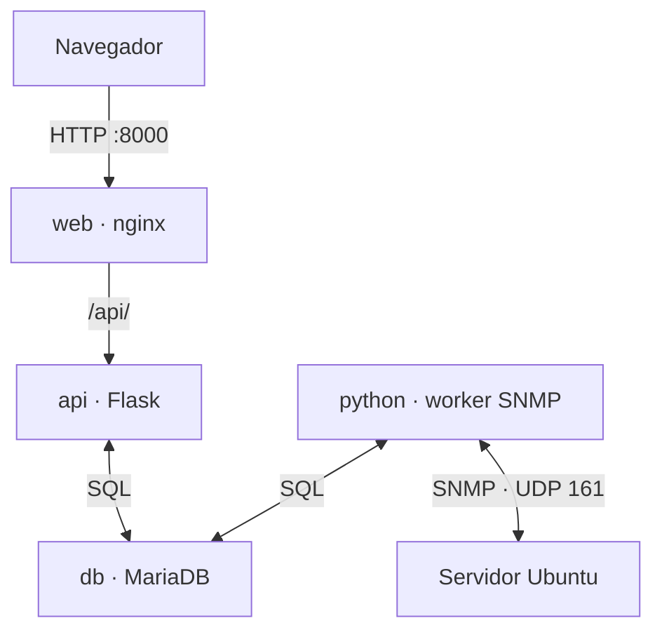

# Nodo · Proyecto Docker 2026

Monitor **SNMP v2c para servidores Ubuntu**, hecho para una presentación de Linux y virtualización. Cuatro contenedores, tres Dockerfiles sencillos y un único `docker-compose.yml`.

## Qué hace

- Dashboard con una tarjeta por servidor y gráficos de CPU, memoria y tiempo de respuesta.
- Alta, edición, pausa y eliminación de servidores desde la página.
- Pestaña **Estado de la app** con el estado de los cuatro contenedores, consultado a Docker.
- Guarda siete días de historial en MariaDB.

## Los cuatro servicios



| Servicio | Qué hace | Carpeta |
|---|---|---|
| `db` | Guarda los servidores y sus mediciones | `DB/` |
| `python` | Consulta cada servidor por SNMP y guarda el resultado | `Python/` |
| `api` | Lee y guarda datos para la página | `API/` |
| `web` | nginx: entrega la página y reenvía `/api/` al servicio `api` | `Web/` |

Sólo `web` publica un puerto. El navegador habla con nginx, y nginx le pasa a `api` los pedidos que empiezan con `/api/`.

## Puesta en marcha

Requisitos: Docker con **Docker Compose v2** y un Ubuntu con SNMP habilitado (ver más abajo).

```bash
git clone https://github.com/GonBlank/proyecto_docker_2026.git
cd proyecto_docker_2026

# Crear la configuración y cambiar las dos contraseñas de ejemplo.
cp .env.example .env

# Construir las imágenes e iniciar los cuatro servicios.
docker compose up -d --build

# Ver el estado: db debe aparecer como healthy.
docker compose ps
```

Abrir **http://localhost:8000** y, en **Agregar host**, cargar la IP del Ubuntu, el puerto `161` y la community SNMP.

No usar `127.0.0.1` como IP del Ubuntu: dentro del contenedor esa dirección apunta al propio contenedor.

### Variables del `.env`

| Variable | Uso |
|---|---|
| `DB_NAME`, `DB_USER` | Nombre de la base y del usuario |
| `DB_PASSWORD`, `DB_ROOT_PASSWORD` | Contraseñas: **cambiarlas** |
| `WEB_BIND_IP` | `127.0.0.1` sólo esta PC; `0.0.0.0` para otras PCs de la red |
| `WEB_PORT` | Puerto de la página (8000) |
| `POLL_INTERVAL` | Segundos entre consultas SNMP |
| `RETENTION_DAYS` | Días de historial que se guardan |

## Preparar el Ubuntu monitoreado

```bash
sudo apt update
sudo apt install -y snmpd snmp
sudo nano /etc/snmp/snmpd.conf
```

Configuración mínima. Reemplazar `192.168.1.10` por la IP de la PC donde corre Docker y `mi_community_lab` por la community elegida:

```conf
agentAddress udp:161
rocommunity mi_community_lab 192.168.1.10/32 .1
```

```bash
sudo systemctl restart snmpd

# Probar desde otra máquina (192.168.1.20 = IP del Ubuntu).
snmpget -v2c -c mi_community_lab 192.168.1.20 1.3.6.1.2.1.1.5.0
```

SNMP v2c envía la community sin cifrar: usarlo sólo en la red del laboratorio.

## Qué explicar sobre Docker

1. **Imágenes:** `db` usa la imagen oficial de MariaDB; `web` parte de `nginx`; `api` y `python` parten de `python:3.12-slim`.
2. **Dockerfile:** `FROM` elige la imagen base, `WORKDIR` la carpeta, `COPY` copia archivos, `RUN` instala dependencias y `CMD` indica qué ejecutar.
3. **Puertos:** `ports` publica el puerto 80 de nginx como 8000 en la PC. Los demás servicios no publican puertos.
4. **Red:** Compose crea una red donde cada servicio se encuentra por su nombre (`db`, `api`).
5. **Persistencia:** la carpeta `DB/data` guarda los datos aunque se borren los contenedores.
6. **Arranque:** `depends_on` con `healthcheck` hace que `api` y `python` esperen a que MariaDB esté lista.
7. **Configuración:** las variables se escriben en `.env` y Compose las pasa a cada servicio.

### Demostración

1. `docker compose up -d --build` y `docker compose ps`.
2. Agregar un Ubuntu desde la página y ver sus gráficos.
3. Detener `snmpd` en el Ubuntu: el host pasa a “Sin respuesta”.
4. `docker compose stop python` y ver el cambio en **Estado de la app**; después `docker compose start python`.
5. `docker compose down` y `docker compose up -d`: los datos siguen ahí.

## Comandos útiles

```bash
docker compose ps                      # estado de los servicios
docker compose logs -f python          # ver lo que hace el worker
curl http://localhost:8000/api/health  # probar web → api → db
docker compose up -d --build           # aplicar cambios del código
docker compose down                    # detener todo (conserva DB/data)
```

| Problema | Qué revisar |
|---|---|
| La página abre pero sin datos | `docker compose logs api` |
| Host “Sin respuesta” | IP, puerto 161, community y firewall del Ubuntu |
| No abre desde otra PC | `WEB_BIND_IP=0.0.0.0` en `.env` y firewall |
